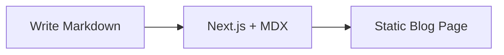

# Iswan Jumat — Personal Blog

A minimalist personal blog built with **Next.js 16 (App Router)**, **MDX (`@next/mdx`)**, **Tailwind CSS v4**, and **Mermaid** diagram support.

## Features

- **File-based Markdown/MDX routes**: Each blog post lives as a `page.md` or `page.mdx` file under `src/app/(posts)/<slug>/` and is automatically listed on the home page sorted newest-first.
- **Static centered header**: Persists across the home page and all post pages with the same reading column width (`max-w-2xl`).
- **Custom dark theme & typography**: Charcoal slate background (`rgb(40, 44, 53)`), white text, warm amber accents (`#bc8a01`), **Montserrat** for headings/titles, and **Merriweather** for body text and dates.
- **Mermaid diagrams**: Write standard ```` ```mermaid ```` fenced code blocks in any `.md` or `.mdx` post to render dark-themed SVG diagrams (free & open-source via `mermaid`).

## Getting Started

Install dependencies and start the development server:

```bash
pnpm install
pnpm dev
```

Open [http://localhost:3000](http://localhost:3000) in your browser.

### Scripts

| Command | Description |
| --- | --- |
| `pnpm dev` | Start the Next.js development server |
| `pnpm build` | Create an optimized production build |
| `pnpm start` | Serve the production build |
| `pnpm lint` | Run ESLint |

## Project Structure

```text
├── public/
│   └── profile.jpg                         # Header profile avatar
└── src/
    ├── mdx-components.tsx                  # Global MDX element styles & Mermaid hook
    ├── lib/
    │   ├── constants.ts                    # Configurable links (e.g., LINKEDIN_URL)
    │   └── posts.ts                        # Scans src/app/(posts)/ for the home page list
    ├── components/
    │   ├── Header.tsx                      # Static site header ("Iswan Jumat" + avatar)
    │   └── Mermaid.tsx                     # Client-side Mermaid diagram renderer
    └── app/
        ├── globals.css                     # Theme variables, fonts, and callout styles
        ├── layout.tsx                      # Root layout & Google Fonts (Montserrat, Merriweather)
        ├── page.tsx                        # Home page blog list
        └── (posts)/
            ├── layout.tsx                  # Shared article wrapper + "Back to all posts" link
            └── <slug>/
                └── page.md                 # Individual blog post (or page.mdx)
```

## Adding a New Blog Post

1. Create a folder under `src/app/(posts)/<your-slug>/`.
2. Add a `page.md` (or `page.mdx`) file with an exported `metadata` object at the top:

```mdx
export const metadata = {
  title: "Your Post Title",
  date: "2026-11-21",
  description: "A short summary displayed on the home page.",
};

# Your Post Title

<p className="text-[13px] text-white/65 -mt-1 mb-8">November 21, 2026</p>

Write your blog content here in Markdown or MDX...
```

Your post will automatically appear on `/` sorted by `date` (newest first) and be served at `/<your-slug>`.

## Rendering Mermaid Charts

Inside any `.md` or `.mdx` post, add a standard fenced `mermaid` code block:

````markdown

````

Mermaid is loaded lazily in the browser only on pages that include a diagram.

## Customization

- **LinkedIn / Profile Link**: Update `LINKEDIN_URL` in `src/lib/constants.ts`.
- **Profile Photo**: Replace `public/profile.jpg`.
- **Favicon**: Replace `src/app/favicon.ico`.
- **Colors & Fonts**: Edit `src/app/globals.css` and `src/app/layout.tsx`.
