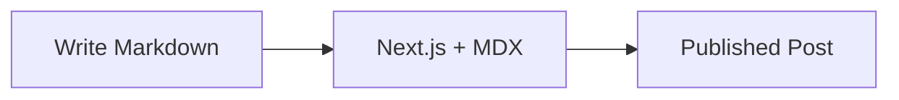

# Minimalist Next.js + MDX Blog & Resume

A minimalist personal blog and printable resume website built with **Next.js 16 (App Router)**, **MDX (`@next/mdx`)**, **Tailwind CSS v4**, **Shiki syntax highlighting**, and **Mermaid** diagrams—fully customizable from a single configuration file (`src/blog.config.ts`).

---

## 1. Create Your Own Blog & Setup Guide

You can scaffold your own copy of this blog (pre-loaded with **1 sample blog post**, **1 sample resume**, and a placeholder avatar) using a single command.

### Step 1: Scaffold a New Blog

Run one of the following commands in your terminal:

```bash
# Using npx
npx create-mdx-blog my-blog

# Using pnpm
pnpm create mdx-blog my-blog

# Using npm
npm create mdx-blog@latest my-blog

# Using yarn
yarn create mdx-blog my-blog
```

Then navigate into your project folder and install dependencies:

```bash
cd my-blog
pnpm install
pnpm dev
```

Open [http://localhost:3000](http://localhost:3000) in your browser.

---

### Step 2: Configure Colors, Text & Links (`src/blog.config.ts`)

Open `src/blog.config.ts` to customize your entire website from one place:

```ts
export const blogConfig: BlogConfig = {
  site: {
    name: "Your Name",
    title: "Your Name",
    tagline: "Software Engineer · Web Architecture",
    description: "Personal blog and resume of Your Name.",
    url: process.env.NEXT_PUBLIC_SITE_URL ?? "https://your-domain.com",
    copyright: "© 2026 Your Name",
  },
  author: {
    name: "Your Name",
    jobTitle: "Software Engineer",
    avatar: "/avatar.svg", // Place your photo in public/ (e.g. "/profile.jpg")
    avatarLink: "https://linkedin.com/in/your-handle",
    phone: "+1 (555) 019-2834",
    email: "hello@your-domain.com",
    linkedinUrl: "https://linkedin.com/in/your-handle",
    linkedinLabel: "linkedin.com/in/your-handle",
  },
  theme: {
    background: "rgb(40, 44, 53)", // Page background color
    foreground: "#ffffff",        // Main body text color
    accent: "#bc8a01",            // Titles, links & highlights
    accentHover: "#d9a212",       // Link hover color
    surface: "#1d2027",           // Code blocks, callouts & Mermaid cards
  },
  social: {
    linkedin: "https://linkedin.com/in/your-handle",
    github: "https://github.com/your-handle",
    instagram: "https://instagram.com/your-handle",
  },
  footerLinks: [
    { label: "Resume", href: "/resume", external: false },
    { label: "LinkedIn", href: "https://linkedin.com/in/your-handle", external: true },
    { label: "GitHub", href: "https://github.com/your-handle", external: true },
    { label: "Instagram", href: "https://instagram.com/your-handle", external: true },
  ],
  labels: {
    backToPosts: "← Back to all posts",
    emptyPosts: "No blog posts yet.",
    printResume: "Save / Print PDF",
  },
};
```

---

### Step 3: Update Your Avatar, Favicon & Resume

1. **Profile Picture**: Add your photo to `public/profile.jpg` and set `author.avatar: "/profile.jpg"` in `src/blog.config.ts`.
2. **Favicon**: Replace `src/app/favicon.ico` with your own icon.
3. **Resume (`/resume`)**: Edit `src/app/resume/page.md` in Markdown. The contact header is generated automatically from `blogConfig.author`, and visitors can click **Save / Print PDF** for a print-formatted copy.

---

### Step 4: Write & Publish Blog Posts

1. Create a new folder under `src/app/(posts)/<your-post-slug>/`.
2. Add a `page.md` (or `page.mdx`) file with `export const metadata` at the top:

```mdx
export const metadata = {
  title: "My First Blog Post",
  date: "2026-11-21",
  description: "A short summary displayed on the home page.",
};

Write your Markdown content here! The post title, formatted date, and estimated reading time are rendered automatically at the top of the page.
```

#### Embedding Mermaid Charts

Use a fenced `mermaid` code block inside any `.md` or `.mdx` post to render interactive diagrams with full-screen zoom:

````markdown

````

---

## 2. Local Setup & Repository Guide (For Contributors / Maintainers)

If you cloned this repository directly to run or maintain the project locally, follow the steps below.

### Prerequisites

- **Node.js** `>= 20`
- **pnpm** (recommended) or `npm` / `yarn`

### Install & Run Locally

```bash
# 1. Install dependencies
pnpm install

# 2. Start the local development server
pnpm dev
```

Visit [http://localhost:3000](http://localhost:3000) to preview the site.

### Available Scripts

| Command | Description |
| :--- | :--- |
| `pnpm dev` | Start the Next.js development server with Turbopack |
| `pnpm build` | Build the production application and prerender static routes |
| `pnpm start` | Start the production server |
| `pnpm lint` | Run ESLint checks |

### Project Structure

```text
├── public/
│   └── profile.jpg                         # Profile avatar image
├── packages/
│   └── create-mdx-blog/                    # CLI scaffolder package (npx create-mdx-blog)
│       ├── bin/index.mjs                   # CLI entry point
│       ├── scripts/build-template.mjs      # Syncs app engine & overlays sample data
│       └── sample-overrides/               # Sample config, 1 sample post & sample resume
└── src/
    ├── blog.config.ts                      # Central configuration (colors, text, links)
    ├── mdx-components.tsx                  # MDX typography, code blocks & Mermaid hook
    ├── lib/
    │   ├── constants.ts                    # Config exports for SEO routes
    │   └── posts.ts                        # Post scanner & reading-time calculator
    ├── components/
    │   ├── Header.tsx                      # Static top header
    │   ├── Footer.tsx                      # Fixed bottom bar
    │   ├── PostHeader.tsx                  # Auto-rendered post title, date & reading time
    │   ├── ResumeHeader.tsx                # Resume contact header + Print PDF button
    │   ├── CodeBlock.tsx                   # Syntax-highlighted code block with Copy button
    │   ├── Mermaid.tsx                     # Mermaid diagram renderer + fullscreen modal
    │   └── LazyMermaid.tsx                 # Dynamic client loader for Mermaid
    └── app/
        ├── globals.css                     # Theme variables, fonts & print styles
        ├── layout.tsx                      # Root layout, SEO metadata & JSON-LD
        ├── page.tsx                        # Home page blog list
        ├── opengraph-image.tsx             # Dynamic OpenGraph social preview card
        ├── sitemap.ts                      # Dynamic /sitemap.xml
        ├── robots.ts                       # /robots.txt
        ├── rss.xml/route.ts                # /rss.xml feed
        ├── resume/page.md                  # Online & printable resume page
        └── (posts)/
            ├── layout.tsx                  # Shared post layout
            └── <slug>/page.md              # Individual blog posts
```

### Building & Publishing the CLI Scaffolder

When you update components in the root app and want to publish a new version of `create-mdx-blog`:

```bash
cd packages/create-mdx-blog

# Test generating the clean template locally
npm run build:template

# Publish to npm (automatically runs build:template via prepack)
npm publish --access public
```

### Publishing Future Updates

Whenever you improve components in your blog and want to release a new CLI version:

```bash
cd packages/create-mdx-blog
npm version patch   # bumps 0.1.0 -> 0.1.1
npm publish --access public
```
