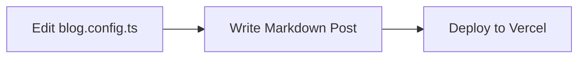

export const metadata = {
  title: "Welcome to Your New MDX Blog",
  date: "2026-11-21",
  description:
    "How to customize your theme colors, author profile, and write Markdown posts with code highlighting and Mermaid diagrams.",
};

Welcome to your new personal blog! Everything on this site—your name, theme colors, social links, and resume header—is controlled from a single configuration file at `src/blog.config.ts`.

## 1. Customizing Your Site

Open `src/blog.config.ts` to update your name, bio, social links, and color palette:

```ts
export const blogConfig = {
  site: {
    name: "Your Name",
    title: "Your Name",
    url: "https://your-domain.com",
  },
  theme: {
    background: "rgb(40, 44, 53)",
    foreground: "#ffffff",
    accent: "#bc8a01",
    accentHover: "#d9a212",
    surface: "#1d2027",
  },
};
```

<div data-node-type="callout">
  <div data-node-type="callout-emoji">💡</div>
  <div data-node-type="callout-text">
    <strong><em>Tip: </em></strong>
    <em>Replace <code>public/avatar.svg</code> with your own photo and update <code>author.avatar</code> in <code>src/blog.config.ts</code>.</em>
  </div>
</div>

## 2. Writing Blog Posts

Create a new folder under `src/app/(posts)/<your-slug>/page.md` (or `page.mdx`). The post title, date, and estimated reading time are rendered automatically from `export const metadata`.

## 3. Mermaid Diagrams

Fenced `mermaid` code blocks render automatically with a full-screen lightbox view:


